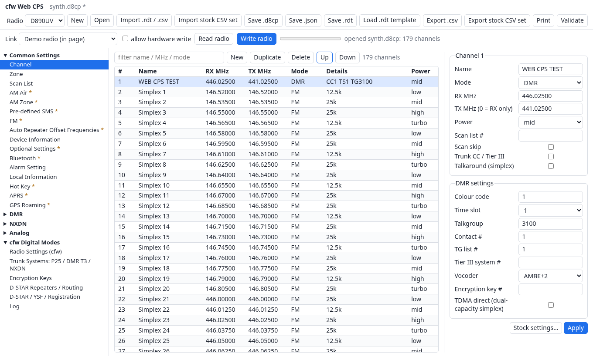

# cfw_cps: codeplug programming software for the D890UV and D168UV custom firmware

This is a CPS for the custom firmware in `../cfw` (D890UV) and `D168UV/cfw` (D168UV, see "D168UV" below). It does **codeplug programming only**. It cannot flash firmware, and it never touches the bootloader, the option bytes or the stock NAND.

There are three front ends. They share one codeplug format and produce identical bytes:

| Front end | Where | Notes |
|---|---|---|
| Desktop: CLI + Tkinter GUI | `cfw_cps.py` | Python 3, standard library only (PyYAML optional, for YAML export) |
| Stand-alone x86-64 binaries | `dist/cfw_cps-linux-x86_64`, `dist/cfw_cps-windows-x64.exe` | The desktop CPS built with PyInstaller; no Python needed |
| Web CPS | `web/` ([web/README.md](web/README.md)) | Static HTML/JS, works offline; Web Serial, or the WebSocket bridge for the emulator |



## Stock CPS parity + digital modes

The cfw CPS follows the stock D890UV CPS V1.05 (mapped in [docs/STOCK_CPS_MAP.md](docs/STOCK_CPS_MAP.md)):

* **Same tree:** Common Settings (Channel, Zone, Scan List, AM Air, AM Zone, Pre-defined SMS, FM, Auto Repeater Offset
  Frequencies, Device Information, Optional Settings, Alarm Setting, Local Information, Hot Key, APRS, GPS Roaming),
  DMR (Master ID, Radio ID List, Contact/Talk Group, Roaming Channel, Roaming Zone, Receive Group Call List,
  Encryption / ARC4 / AES codes, Digital Contact List, whitelists), NXDN (NX Setting, talk groups, RX group lists,
  encryption, state messages, contacts) and Analog (address book, 2/5-Tone, DTMF, MDC1200, alert tones, hot keys).
* **Same data:** all 38 tables of the stock "Export All", with the stock column names, order and defaults
  (`schema/stock_d890uv.json`). Optional Settings show the stock dialog's 17 tabs with the stock labels.
  Stock data cfw does not use yet is stored in the codeplug and marked *not used by cfw yet* (`*` in the web tree).
* **Same files:** import/export the stock CSV set (.LST + 38 CSV) byte for byte; import D878UV (V1270) `.rdt`;
  open / save the stock D890UV `.rdt` (V1323). Open + save gives the same bytes (a 6.4 MB real codeplug included).
  An `.rdt` that was not opened from one is written on cfw_cps's built-in blank file, or on your own stock CPS
  "new file" when you give one (see "Stock CPS files"). These
  edits are written into the `.rdt`:
  * channels, with all 77 stock columns: the fixed record plus 32 tail bytes found by the mapping (DMR mode, ARC4,
    the NXDN extras, ...);
  * zones, scan lists, talkgroups, contacts, SMS, FM, RX groups, radio IDs;
  * the power-on texts / password;
  * the 196 mapped Optional Setting fields;
  * NX Setting, checked against a file saved by the stock CPS itself.

  The other tail tables (APRS, roaming, alert tones, hot keys, ...) are kept byte for byte; an edit to them is reported
  as "not written into the .rdt" (use the stock CSV set). Layout: docs/STOCK_CPS_MAP.md.
* **Same workflow:** File (New, Open, Save, Save As, Import, Export, Print to file), Program (Read From Radio,
  Write To Radio with a diff first), Tool (Validate, Diff).

Added for the cfw digital modes ("cfw Digital Modes" in the tree, plus per-mode fields in the channel editor):

| Mode | Per channel | Systems / lists |
|---|---|---|
| DMR | CC, slot, TG, contact, RX group list, Tier III system, talkaround, TDMA direct (dual-capacity simplex), vocoder, key | Tier III systems: control channels (site list), channel plan, TG priority list, home site, registration |
| P25 Ph1/Ph2 | NAC, TG, slot (Ph2), WACN / system ID, talkaround, vocoder, key | trunk systems: WACN, SysID, RFSS / site, control channels, band plans (IDEN_UP, FDMA/TDMA), Phase 2 flag, registration |
| NXDN | RAN, group, NXDN48/96, Type-C/D system, vocoder, key | Type-C / Type-D systems: control channels, RAN, band plan |
| D-STAR | UR / RPT1 / RPT2, repeater list entry | repeater / routing list, D-PRS (GPS), slow-data message, MY = callsign |
| YSF | RX / TX DG-ID, DN / VW / DATA, Wires-X | Wires-X room, auto connect |
| all | encryption keys (user-entered: DMR BP / ARC4 / AES, P25 DES / AES / ADP, NXDN scrambler / DES / AES) | |

Every new field is in the codeplug format (docs/CODEPLUG.md sections 10-15), the CLI, the web app and the binaries, and
is validated; the JS and Python encoders produce identical bytes (tests/vectors: `digital`, `synth`, `synthstock`).

## D168UV

The same CPS programs the D168UV cfw (`D168UV/cfw`, AT32F403A). One code base, a **radio model** per codeplug:

| | D890UV | D168UV |
|---|---|---|
| Stock CPS it follows | D890UV CPS V1.05 (`docs/STOCK_CPS_MAP.md`) | D168UV CPS V1.07 (`docs/STOCK_CPS_MAP_D168.md`) |
| Stock schema | `schema/stock_d890uv.json`, 38 tables | `schema/stock_d168uv.json`, 28 tables (no NXDN / AM / whitelists; QDC1200 tables) |
| Tree | Common Settings / DMR / NXDN / Analog | Public / Digital / Analog, as in the stock D168 CPS |
| Stock .rdt | V1323, model "D890UV" | V1292, model "D168UV" (layout: `cps/rdt.py` LAYOUT) |
| Codeplug | "D8CP" v1, header model id 0 | the same format, header model id 1 (`docs/CODEPLUG.md`) |
| Radio link ident | `D890CFW` | `D168CFW` (USART1 PA9/PA10 115200, region 0x080A0000, 384 KB) |

* **Model switch:** GUI toolbar "Radio" and File > Radio model (converts the open codeplug), File > New D168UV codeplug;
  web: the "Radio" selector next to New (`index.html?model=D168UV` starts with a D168 codeplug); CLI:
  `cfw_cps.py new --model D168UV -o x.d8cp`, `import SRC --model D168UV`, `export FILE --model D168UV -o OUT`, `gui --model D168UV`.
* **Conversion** keeps all cfw data (channels with every digital mode, zones, scan lists, contacts, TG lists, trunk
  systems, keys, D-STAR repeaters, digital settings). Stock CPS tables both CPS have keep their common columns; tables /
  columns the target CPS does not have are dropped (NXSetting, AM Air, ... going to the D168).
* **Files:** the stock D168 CSV set (Tool > Export > Export All of the D168 CPS: `.LST` + 28 CSV) is detected by its
  file names and imported / exported byte for byte; stock D168 `.rdt` files open and save byte-identical (channels,
  zones, scan lists, talkgroups, contacts, SMS, FM, RX groups, radio IDs, power-on texts and the mapped Optional
  Settings are written into it). D878UV `.rdt`, CHIRP and cfw CSV import as for the D890 (`--model D168UV`
  converts).
* **Safety:** a D890UV codeplug is not written to a D168UV radio or vice versa; the link refuses any radio that is not
  a cfw (`D890CFW` / `D168CFW`).
* **Digital modes:** all cfw digital settings (DMR incl. Tier III trunking, P25 Phase 1/2 + trunking, NXDN incl. Type-C/D,
  D-STAR, YSF, encryption keys) are model independent and are in the D168 tree under "cfw Digital Modes" (Tier III
  Systems also under Digital), and in the channel editor.
* **Bluetooth page** (Public > Bluetooth, and a Bluetooth tab in Optional Setting; GUI and web): the stock D168 CPS
  has no BT page, but the radio has a BT menu and the codeplug holds its settings. Labels and value lists are the
  radio's (Settings > BT): BT On/Off, Hold Time (OFF, 1S-30S, 60S, 120S, infinite), RX Delay (30ms, 1S-5.5S),
  BT+int spk, Mic Gain / Spk Gain (Level 1-5), plus `BhtPttHold` and `MicInBlueTooth` (stock keys with no radio menu, raw).
  The stored value is the list index (stock CSV value, .rdt byte). Checked: the stock CPS writes these .rdt bytes to the
  radio settings block (fake-radio write capture) and the stock firmware shows them as listed (emulator), see
  `docs/STOCK_CPS_MAP_D168.md` "Bluetooth". BT Names, Pin Code, Pairing / Pair-Names, NR BEL / NR AFL and the PTT Pair
  submenu (PTT HOLD, PTT Name, ...) are set on the radio and are not in the codeplug (checked in the emulator). The D890UV gets the same page with its BT CSV keys
  (incl. `BtNrBefore` / `BtNrAfter`) as raw stock values.

```sh
python3 cfw_cps.py import tests/vectors/stock_synth_d168/synth.LST -o s168.d8cp     # stock D168 CSV set
python3 cfw_cps.py import my_d168.rdt -o my.d8cp                                    # stock D168 .rdt (V1292)
python3 cfw_cps.py export my.d8cp -o my_d168.rdt                                    # back to the stock D168 CPS
python3 cfw_cps.py export s168.d8cp -o s168.rdt                                     # never was an .rdt: built-in blank
python3 cfw_cps.py export my890.d8cp --model D168UV -o my168.d8cp                   # convert a D890UV codeplug
python3 tools/emu_roundtrip.py --model D168UV                                       # round trip vs D168 cfw in Renode
```

Tests: `tests/test_d168.py` (schema, CSV set byte for byte, binary / JSON keep the model, .rdt open + save, conversion,
link with a `D168CFW` fake radio, CLI), `tests/test_gui.py::test_gui_d168_model`, the D168 vectors in `tests/vectors`
(`synthstock_d168`, `digital_d168`; with the private stock files also `new_v1292`, `bt_v1292.rdt` = Bluetooth page
values) checked by `node web/test/run_tests.mjs`.

## Synthetic test codeplug

`tools/make_synth.py` (`make examples`) builds the test codeplug from made-up data: no real callsigns, users or
repeaters (callsign N0CALL, IDs 999xxxx, sites Alpha..Hotel, D-STAR XX0RPT, TG 2/9/91/3100/...). It covers FM
(simplex, repeaters, CTCSS/DCS, RX only), DMR (8 sites x 10 talkgroups, both slots, private call, TDMA direct, Tier III),
P25 (conventional, Phase 2, trunked with band plans), NXDN (48/96, Type-C), D-STAR (repeater list), YSF (DG-ID,
Wires-X), 12 zones, 6 scan lists with priority channels, 3 TG lists, 2 keys, and the stock tables (200-entry user
database, roaming channels / zones, APRS, FM, SMS, radio IDs, Optional Settings incl. Bluetooth) for both models.
Outputs: `examples/synth.d8cp/.json/.csv`, `examples/synth_d168.*`, and the stock CSV sets
`tests/vectors/stock_synth{,_d168}/` (written by cfw_cps; `make vectors` derives the shared vectors from them).

## Stock CPS files

Files made by the stock AnyTone CPS are **not shipped**: its screenshots, its "new file" `.rdt` templates, codeplugs it
saved or exported, and real codeplugs. What needs them:

* **Writing an `.rdt` that was not opened from one** (a new codeplug, a CSV / D878 import, a converted model, new
  channels) starts from a template. Built in: a **blank file cfw_cps generates itself** (`cps/rdt.py` `blank_file`,
  JS `blankFile`): the layout from `LAYOUT` + `rdt_map*.json` filled with the schema's default values, unknown bytes
  zero, plus what the stock CPS checks when it loads a file (found by loading test files into it; without them it
  answers "Get_FileData_Ver_Error" / "file error."): header byte 23 = 1; at least one contact; D890 contact prefix
  bytes 3-4 = contact record bytes + 1 and user-DB prefix bytes 4-6 >= user record bytes + 1; the byte after the user
  DB = 1 when it is empty; the D168 FM VFO record; in the undecoded tail, non-empty strings where the stock reader expects
  them (APRS destination / source / path / comment, a roaming channel and zone, the D890 AM air channel + VFO: our own
  text of the stock lengths, e.g. source `N0CALL`), their record counts and the version trailer. Everything else in the
  tail is zero, so those stock settings (alert tones, hot keys, ...) show as 0 / empty in the stock CPS until set there.
  No byte of a stock file is in it. Vectors: `tests/vectors/blank_v1323.rdt`, `blank_v1292.rdt`, `synth_v1323.rdt`,
  `synth_v1292.rdt` (the synthetic codeplug written on the blank).
  Checked 2026-11-23 under Wine (headless: null graphics driver, no display; Win32 messages from a Windows Python in
  the scratch prefix): the stock D890UV CPS V1.05 and D168UV CPS V1.07 open all four files ("Load File OK"), and their
  re-save is byte for byte the same file; cfw_cps reads it back (179 channels, zones, scan lists, contacts equal).
  Your own template still wins when given: in the stock CPS do File > New, then Save As, and use the file with
  `--rdt-template FILE` (CLI, once per model), `$CFW_CPS_RDT_TEMPLATE_D890UV` / `$CFW_CPS_RDT_TEMPLATE_D168UV`, a
  folder `$CFW_CPS_RDT_DIR` holding `new_v1323.rdt` / `new_v1292.rdt`, the same file names in `~/.config/cfw_cps/`, or
  the web CPS's "Load .rdt template" (kept in the browser). Opening a stock `.rdt` and saving it again (with edits)
  uses that file itself.
* **Tests** that compare with stock-CPS-made files read them from `$CFW_CPS_PRIVATE` and are skipped without it:
  `templates/new_v1323.rdt`, `templates/new_v1292.rdt`, `d878.rdt` (a D878UV codeplug for the importer, or
  `$CFW_CPS_D878_RDT`), `vectors/` (stock-saved `.rdt` files, the stock CSV exports `stock_csv_d890/`, `stock_csv_d168/`
  with `export.LST`, and the vectors `make vectors` derives from them), `schema/stock_defaults{,_d168}/` (the stock
  "Export All" of a new codeplug, input of `tools/make_stock_schema.py`; the generated `schema/*.json` are shipped).
  The default for `$CFW_CPS_PRIVATE` is `../../private/cfw_cps` next to the source tree.

## Use

```sh
cd D890UV_src/cfw_cps
python3 cfw_cps.py import my_d878.rdt -o my.d8cp     # AnyTone .rdt -> cfw
python3 cfw_cps.py gui examples/synth.d8cp           # the synthetic test codeplug
python3 cfw_cps.py gui my.d8cp                       # editor (File / Radio / Tools menus)
python3 cfw_cps.py validate my.d8cp
python3 cfw_cps.py write tcp:localhost:3470 my.d8cp  # diff, confirm, write, read back, compare
python3 cfw_cps.py read  tcp:localhost:3470 -o radio.d8cp
python3 cfw_cps.py export my.d8cp -o my.json         # also .yaml, .csv, .LST (stock CSV set), .html (print)
python3 cfw_cps.py import stock_export/export.LST -o my.d8cp   # stock CPS "Export All" set
python3 cfw_cps.py diff a.d8cp b.json
python3 cfw_cps.py info tcp:localhost:3470
make test        # unit tests (pytest), including the JS core vs the Python vectors
make emu-test    # round trip against the cfw running in Renode
# hand testing: front panel + CPS on one emulated radio (emu/webui.py --uart-socket)
python3 ../emu/webui.py --launch cfw --uart-socket usart1:3470   # then: cfw_cps.py gui (port tcp:localhost:3470)
```

## Binaries (x86-64)

```sh
dist/cfw_cps-linux-x86_64 gui my.d8cp                   # same commands as cfw_cps.py
wine dist/cfw_cps-windows-x64.exe ...  /  on Windows: cfw_cps-windows-x64.exe read COM3 -o radio.d8cp
make exe                                                 # = tools/build_exe.sh linux (PyInstaller onefile)
WINEPREFIX=/path/to/scratch/prefix PY_WIN_INSTALLER=python-3.12.10-amd64.exe make exe-win
```

* **`make exe`** uses PyInstaller if it is installed. If not, it creates `build/venv` and installs PyInstaller there.
* **`make exe-win`** builds under Wine. The prefix must be a scratch prefix, never `~/.wine`. On the first run it installs the given python.org Windows installer (with Tcl/Tk) into the prefix, then runs PyInstaller there.
* **On Windows itself:** run `py -m pip install pyinstaller && py -m PyInstaller --onefile --name cfw_cps-windows-x64 --distpath dist cfw_cps.py` in `cfw_cps\`.
* **Serial ports:** the binaries reach `tcp:` ports (emulator) and serial ports. Linux uses termios. Windows `COMn` goes through kernel32 via ctypes, so no pyserial is needed.

Checked on this machine (2026-11-20; rebuilt and re-checked 2026-11-21):

| Check | Linux binary | Windows .exe (Wine 10) |
|---|---|---|
| Size | 12.7 MB | 10.5 MB |
| `import` a real D878UV codeplug | same 96 592 bytes as the Python CPS | same 96 592 bytes as the Python CPS |
| `validate` / `export` / `--help` | ok | ok |
| 2026-11-21: stock CSV set, `digital` vector, stock `.rdt` open + save byte-identical, NX Setting from `.rdt` | ok | ok |
| `write` + verify + `read` | fake radio over TCP: ok | fake radio over TCP: ok |
| COM port | — | COM9 → pty → fake radio: ok, and a write without `--allow-hardware` is refused |
| GUI | starts | starts |

The .exe has not been run on real Windows.

## Web CPS

```sh
cd web && python3 -m http.server 8000 --bind 127.0.0.1        # http://localhost:8000/   (or: make web)
python3 tools/ws_bridge.py --target tcp:localhost:3471 --http 8000   # + WebSocket bridge to the emulator USART1
```

The web CPS has the same features as the desktop one:
* open / save `.d8cp` / `.json`;
* `.rdt` and CSV import, CSV export;
* channel table with per-mode fields;
* zones, scan lists, TG lists, contacts, trunk systems and settings;
* validation;
* a diff dialog before writing, and read-back verification after.

Radio links are Web Serial (Chrome / Edge), the WebSocket bridge and an in-page demo radio. The JS core (`web/js/codeplug.js`, `importers.js`) is a port of `cps/`. The shared vectors in `tests/vectors` (`make vectors`) keep the two sides byte-identical: encode, decode, validation messages, diff lines, `.rdt` and CSV import.

| Test | Result |
|---|---|
| `node web/test/run_tests.mjs`: JS vs Python vectors + the protocol against a JS model of `prog.c` | 32 / 32 |
| `make web-test`: headless Chromium, demo radio. Open `examples/synth.d8cp` → 179 rows, edit through the form, CC 99 refused, zones tab, diff dialog → Write, verified, read back byte for byte | see "Tested" |
| `make web-emu-test`: the same page through `ws_bridge.py` into the cfw in Renode. Radio screen shows the written channel; after power off/on it is still there; the Python CLI reads the same 96 592 bytes | PASS |

Screens: `screens/web_*_demo.png` (synthetic codeplug), `screens/web_emu_after_write.png`. The browser tests need `playwright-core` on `NODE_PATH` (`npm i playwright-core`) and an installed Chromium (`/usr/bin/chromium`). No browser download is needed.

| Input (`import`, GUI File > Import) | What is read |
|---|---|
| `.rdt` (AnyTone D878UV / D890UV CPS) | Channels, zones, scan lists, talkgroups / contacts, RX group lists, radio ID. The user database is counted, not imported. |
| `.csv`, CHIRP layout | FM channels: duplex / offset / split, Tone / TSQL / DTCS / Cross, skip |
| `.csv`, cfw layout | Every mode; columns as in `export x.csv` (`name, rx_mhz, tx_mhz, mode, bw, power, rx_tone, tx_tone, cc, slot, tg, contact, nac, wacn, sysid, ran, dgid, ur, rpt1, rpt2, trunk, scanlist, zone`; zones separated by `|`) |
| `writes.bin` / raw D890UV memory image | Channels only, using the stock layout in `cfw/app/channels.c` |
| `.d8cp`, `.json`, `.yaml` | A cfw codeplug |

The format is described in [docs/CODEPLUG.md](docs/CODEPLUG.md): binary layout, link protocol, RDT layout, validation rules.

**GUI.** The tabs are:
* Channels: table plus an editor, with per-mode fields for FM, DMR, P25, P25P2, NXDN, D-STAR and YSF. Use Apply to store an edit.
* Zones, Scan lists and TG lists: list editors with ordered members.
* Contacts / TGs.
* Trunk systems: P25 or DMR Tier III, with control channels, WACN / system ID / NAC and a TG priority list.
* Settings.
* Log.

Radio > Write validates the codeplug first and refuses on errors. It then reads the radio and shows the diff in a dialog, and writes only after you confirm. Afterwards it reads the codeplug back and compares it. Edits shift the zone and scan list references when channels are inserted, deleted or moved.

## Radio side

The radio side is in `cfw/app/prog.c` (link) and `cfw/app/cfwcp.c` (store and loader), with small hooks in `main.c`, `channels.c`, `radio.c`, `ui.c`, `startup.c` and the linker script (agreed with the platform session).

* **Link:** USART1 (the programming cable), 115200 baud. Framing is the stock `PROGRAM` / `02` / `R` / `W` / `END`, and the cfw identifies as `D890CFW`. The protocol is in docs/CODEPLUG.md "Link". USB CDC is not implemented; the cfw has no USB stack yet.
* **Storage:** internal flash `0x081C0000–0x081DFFFF` (128 KB), written only by `cfwcp.c` under an address guard. The cfw image now ends at `0x081BFFFF`. The NAND stays read-only.
* **Boot:** if a valid cfw codeplug is present (magic, version and CRC all check out), its channels replace the NAND channels. The built-in demo channels follow after them. The settings (ID, callsign, step, RX polarity, de-emphasis, test tone, start channel) become the defaults; menu edits that were saved later still win.
* **After a write:** END makes the radio reload its channels, drop the old per-channel overrides and save its state.
* **While in program mode:** the screen shows `PROGRAM MODE`, keys and PTT are ignored, and replies go out from the UART interrupt, so the main loop never waits.
* **`make HW=1`:** the link is compiled out unless `CFW_PROG_HW` is defined, because the USART1 pins PB6/PB7 are not confirmed on the radio. Even with it, codeplug writes are refused; the radio reports itself as write-protected.

## Safety

* The CPS only speaks the codeplug protocol. It has no firmware, bootloader, option-byte or NAND command.
* It refuses radios that do not identify as `D890CFW`, so a stock D890UV is never written.
* Writing over a serial device needs `--allow-hardware`. Do not use it until the owner has approved writes to real hardware (CLAUDE.md). The only allowed path for anything flash-related on hardware is `tools/hw/hw.py`. Real-hardware testing has **not** been done.

## Tested

2026-11-23 (synthetic test codeplug; stock CPS files present = with `$CFW_CPS_PRIVATE`):

| Suite | With stock files | Without |
|---|---|---|
| `make test` (pytest, `$DISPLAY` set) | 92 pass | 70 pass, 22 skipped |
| `node web/test/run_tests.mjs` | 85 pass | 52 pass, 13 skipped |
| `web/test/browser_test.mjs` (headless Chromium, demo radio) | 20 pass | 18 pass (`.rdt` open + save skipped) |

Found with the synthetic codeplug: when the stock entries in codeplug section 10 do not end on a 4-byte boundary, the
radio edits journal starts after 1-3 zero padding bytes; the CPS decoders (Python + JS) now skip that padding (before,
`decode` failed with KeyError 'Channel'). The firmware's `stock_walk` in `cfw/app/cfwcp.c` has the same issue.

Earlier, 2026-11-21 (with a real 1405-channel codeplug, since replaced by the synthetic one):

| Suite | Result | What |
|---|---|---|
| `pytest tests` (`make test`) | 64 pass, 2 GUI tests skipped without `$DISPLAY` | Format round trips (binary / JSON / YAML) byte for byte, header layout vs the firmware structs, CRC, tones, validation (incl. every digital rule), size limit, diff, D878UV import, CHIRP / cfw CSV, link vs `fake_radio.py` (write order, cancel, invalid refused, stock radio refused, write-protected build, hardware-port guard), stock CSV set byte for byte, all digital sections, `.rdt` V1323 (open+save identical, edits, OptionalSetting, NX Setting = stock CPS bytes) |
| `pytest tests/test_gui.py` with `$DISPLAY` | 2 pass | GUI: stock tree pages, digital pages, channel edit → write |
| `node web/test/run_tests.mjs` | 47 pass | JS core = Python on every vector (decode / encode / issues / diff / imports / stock CSV / `.rdt` / NX Setting) |
| `web/test/browser_test.mjs` (headless Chromium) | 20 pass | the web app: nav tree, stock pages, keys, channel ext, demo-radio write + verify, `.rdt` open / save byte-identical |
| `tools/web_emu_test.py` | PASS | web app → WebSocket bridge → Renode cfw: write, diff, verify, power cycle, Python CLI reads the same bytes |
| `tools/emu_roundtrip.py` | PASS | Renode cfw (`build_cps`, 384 KB region): a codeplug with every section (9 728 B) and a stock CSV import (205 072 B, more than the old 128 KB): identify, write, END ack, read back byte for byte, screen shows the channel, power cycle, read back again |
| binaries | ok | see "Binaries" |

D168UV (2026-11-21):

| Suite | Result | What |
|---|---|---|
| `pytest tests` | 80 pass (with `$DISPLAY`) | everything above plus `tests/test_d168.py` (13) and the D168 GUI test |
| `node web/test/run_tests.mjs` | 64 pass | adds the D168 vectors: CSV set → same bytes as Python, all 28 files written back byte for byte, conversion, `.rdt` V1292 reader / writer, the stock-CPS-checked file |
| stock D168 CPS V1.07 (Wine) | ok | opens `.rdt` files written by cfw (a real codeplug trimmed; CSV import + an added P25 channel + TOT) and saves them back byte for byte; Optional Setting values written by cfw show in its dialog |
| `make emu-test-d168` | PASS | D168UV cfw (`D168UV/cfw/build/cfw168.elf`) in `D168UV/emu`: identify `D168CFW`, write a 1405-channel codeplug (96 736 B), screen shows the channel, read back byte for byte, power cycle, still there, read back again (`screens/d168_after_write.png`, `d168_after_power_cycle.png`) |
| `make emu-test` (D890UV) | PASS | unchanged after the model work |
| web app in the desktop app's browser | ok | Radio selector → D168 tree, Optional Setting tabs, demo radio (`D168CFW`) write + verify + read |
| binaries | ok | Linux + Windows (Wine) rebuilt: D168 CSV set import = Python bytes, D168 `.rdt` open + save identical, `new --model D168UV` |

Fixes found on the way (both models): the `.rdt` header u32 at offset 5 (file length - 14) is now written (the stock
CPS refuses a file with a stale value); channel records are written in number order and an added channel gets a free
number (the stock CPS merges channels with the same number); only changed Optional Settings are written; the web
CPS wrote "undefined" as colour code of non-DMR digital channels in stock rows.

Earlier emulator run (2026-11-20, 128 KB region):

| Step | Real codeplug (1405 channels, 96 592 B) | All modes (10 channels, 1 296 B) |
|---|---|---|
| Identify + info, no codeplug yet (radio has 1416 NAND + built-in channels) | PASS | PASS |
| Write, END ack, read back identical | PASS | PASS |
| Screen shows the new channel 1 (`screens/after_write.png`) | PASS | PASS |
| Read back byte for byte | PASS | PASS |
| Power off → reset → power on: channel still there (`screens/after_power_cycle.png`) | PASS | PASS |
| Read back again byte for byte, decoded = written | PASS | PASS |

The digital channels show the codeplug fields: `screens/all_modes_ch6_p25_trunk.png` shows NAC 293 TRUNK, and `screens/all_modes_ch9_dstar.png` shows UR CQCQCQ.

## Layout

```
cfw_cps.py            CLI (read / write / import / export / validate / diff / info / show / gui)
cps/codeplug.py       model, binary format (reference encoder), JSON / YAML
cps/validate.py       validation          cps/diff.py   diff before writing
cps/import_rdt.py     AnyTone .rdt        cps/import_csv.py  CHIRP / cfw CSV (+ export)
cps/import_nand.py    stock D890UV memory image (channels)
cps/link.py           protocol client, TCP / serial ports, safety checks
cps/ops.py            read / write with validation, diff, confirm and verify (CLI and GUI)
cps/gui.py            Tkinter GUI
web/                  web CPS (js/codeplug.js, importers.js, link.js, app.js; test/)
tools/ws_bridge.py    WebSocket <-> TCP / pty bridge (stdlib) for the web CPS
tools/web_emu_test.py web CPS round trip against Renode
tools/build_exe.sh    PyInstaller builds (Linux, Windows under Wine)
dist/                 cfw_cps-linux-x86_64, cfw_cps-windows-x64.exe
tests/vectors/        shared Python <-> JS vectors (tests/make_vectors.py)
tests/                pytest; fake_radio.py = Python model of the firmware side
tools/emu_roundtrip.py   emulator round trip (default codeplug examples/synth.d8cp)
tools/make_synth.py   synthetic test codeplug (examples/synth*, tests/vectors/stock_synth*)
examples/             synth.d8cp / .json / .csv, synth_d168.*, all_modes.json
docs/CODEPLUG.md      format + link + RDT layout
```

## Repository layout

This is one of six repositories: D890UV-CFW, D168UV-CFW, D890UV-CFW-CPS, D168UV-CFW-CPS, D890UV-EMU, D168UV-EMU.
The build and test scripts expect them side by side in this layout:

```
work/D890UV/D890UV_src/cfw       <- D890UV-CFW
work/D890UV/D890UV_src/cfw_cps   <- D890UV-CFW-CPS (or D168UV-CFW-CPS)
work/D890UV/D890UV_src/emu       <- D890UV-EMU
work/D168UV/cfw                  <- D168UV-CFW
work/D168UV/emu                  <- D168UV-EMU
```

No firmware, flash images or programming files from the radio maker are included. The emulators build their own
flash images (`emu/make_nand.py` -> `images/synth.pages`); running the original radio firmware in the emulator needs
files made from your own radio package (see the emulator README). Flashing a real radio (CFW repositories): `docs/HARDWARE.md`,
`docs/CALIBRATION.md` and `docs/PREFLASH_AUDIT.md`.
